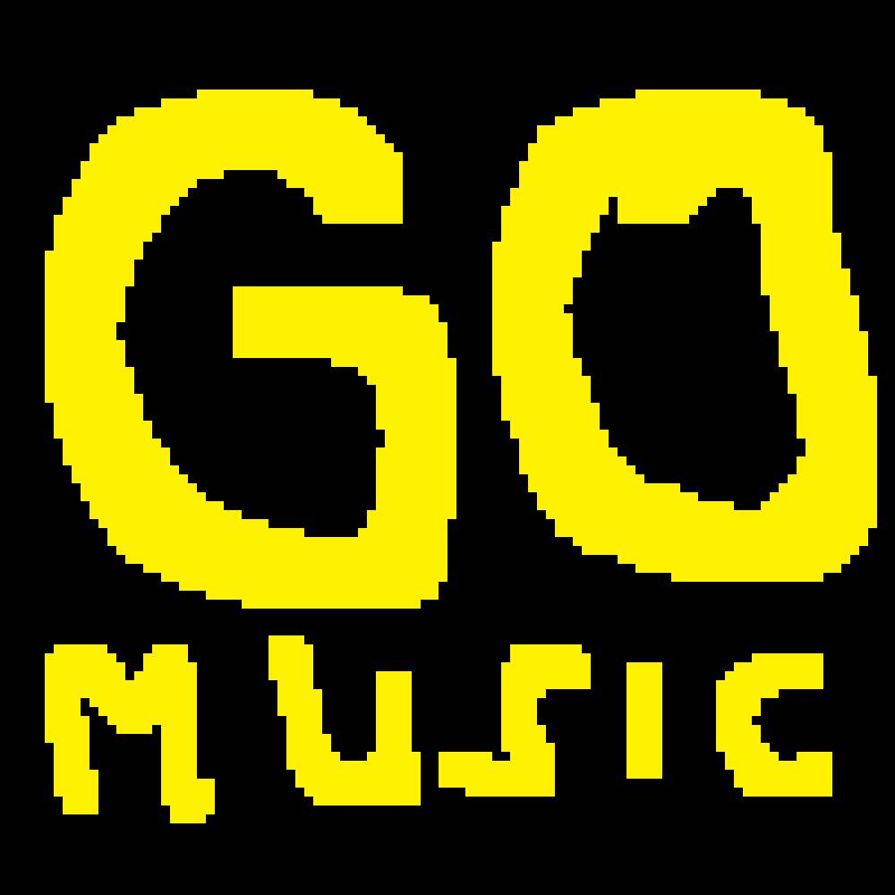

# ♪ GoMusic

A comfortable, beautiful, lightweight terminal music player in Go,
built on the [Charm](https://charm.sh) ecosystem (bubbletea, bubbles,
lipgloss). See [RESEARCH.md](RESEARCH.md) for backend decisions.

- **Controls:** play/pause, previous/next track, ∓5 s seek, shuffle,
  repeat (off/all/one), volume, `?` full help
- **Visualizer:** `v` turns the middle of the screen into a
  full-width spectrum (CAVA-style: bars centered, 2 cells wide with a
  1-cell gap, smoothed with an integral filter on rises and a gravity
  filter on falls; a pause parks them on a low resting row). Bars
  wear a gradient sampled from the song's cover art — the theme
  colors when a track has none
- **Layout:** library on the left, cover art + song card on the right,
  full-width control bar at the bottom (progress + time, state,
  volume, shuffle/repeat, queue position)
- **Now playing card:** embedded cover art (truecolor half-blocks,
  decoded async so the UI never stalls), song title, artist — album
  and a format badge (`MP3 · 44.1 kHz · Stereo`); `▶` marker on the
  playing track in the list
- **Adaptive:** everything scales with the window — fullscreen gets a
  big cover, wide columns and a full-width progress bar; small
  terminals shrink the same arrangement (narrow stacks card under
  the list, tiny hides art and collapses list chrome). The render
  always fits exactly (verified 200×50, 120×32, 90×24, 70×22, 48×14)
- **Settings:** pick the music folder inside the app (`c`)
- **Formats:** mp3, flac, wav, ogg/oga — decoded natively, streamed
  (constant memory, no ffmpeg)
- **Quality:** 48 kHz stereo float32 output, one high-quality resample
  only when the source differs, logarithmic volume (100 % = unity)
- **Platforms:** Linux, Windows, macOS — needs only a C compiler
  (gcc/clang/MinGW) for the bundled miniaudio backend

## Build & run

```sh
go build -o gomusic .
./gomusic
```

The first run installs the `gomusic` command for the terminal
(Linux/macOS: a `~/.local/bin/gomusic` symlink, Windows:
`%LOCALAPPDATA%\gomusic` + user PATH with a live
WM_SETTINGCHANGE broadcast, so even already-open consoles pick it
up) — reopen the terminal afterwards if it was just installed. If `~/.local/bin` is not on
your PATH, the app prints the one `export` line to add.

On each OS just run the same `go build` natively (cgo requires a C
compiler: `gcc` on Linux, Xcode CLT on macOS, MinGW-w64 on Windows).
No system audio dev packages, no external binaries.

Config lives in the OS config dir (`~/.config/gomusic/config.json`
on Linux): music folder, volume, shuffle, repeat — plus the last
session (track + position), which resumes paused on the next start.

## Discord Rich Presence (optional)

`c` → settings menu: the Discord row toggles Rich Presence on/off
(enter), and while it is on a GitHub-button row appears. The status
line shows whether Discord is connected (the official Application ID
is built in). GoMusic finds Discord itself on every OS — Windows
named pipes, macOS sockets, native Linux, plus Flatpak and Snap
installs (sandbox runtime dir `$XDG_RUNTIME_DIR/app/<id>/`, any UID,
`ipc-0..9`, plus a `/proc` fallback). No Discord settings needed:
Rich Presence bypasses game detection entirely (remove any manual
game entry for gomusic to avoid a duplicate "Playing" row).
Presence renders as Listening (type 2): main row is the song title,
second row the artist, plus live progress, always our logo as the
large image, and a GitHub button to this repo (no hover texts or
small image: some clients render them as duplicate rows). The
`logo` asset must be uploaded under the Application ID or the
card degrades.
Note: Discord hides buttons on your *own* activity card — other
people viewing your profile see them, you don't; it updates on track change, pause/resume
and seek, and clears on quit. Pushes are generation-gated (no stale
flashes) and Discord-absent rescans back off, so playback never
waits on Discord.

Setup (once): Discord requires every presence to belong to an
Application — create one at
<https://discord.com/developers/applications> → Rich Presence → Art
Assets → upload `assets/GoMusic-bg.png` as `logo`, then paste the
Application ID into Settings (a future update bakes the official ID
in as the default so this step disappears). Note: Discord only renders images
pre-uploaded under your Application ID, so local song covers can't be
used — the logo is shown and the song rides in the hover text
on Linux): music folder, volume, shuffle, repeat — all persisted.

## Keys

| Key | Action |
| --- | --- |
| `space` / `p` | play / pause |
| `←` / `→` | previous / next track |
| `↑` / `↓` or mouse wheel | move in the list (`enter` plays the highlighted track) |
| `enter` | play selected |
| `+` / `-` | volume ±5 (`shift` = ±1 precise) |
| `m` | mute on/off (volume restores) |
| `a` / `d` | seek -5 s / +5 s |
| `s` | shuffle on/off |
| `r` | repeat off → all → one |
| `u` | refresh library |
| `f` | search by title / artist / album (`esc` clears) |
| `k` or `?` | keybinds on/off |
| `c` | settings (music folder) |
| `y` | download from YouTube / YouTube Music |
| `v` | visualizer: bars colored from the cover art |
| `esc` | back (closes keybinds / current page) |
| `q` | quit |

Hotkeys are layout-independent: Russian ЙЦУКЕН (plus Ukrainian
і/ї/є/ґ) works the same as EN, since keys match by physical position.

Settings is one menu: pick a row with `↑/↓` or the mouse wheel,
change it with `enter` (toggles flip at once). The folder row takes
a pasted/typed path (`~` and quotes work on every OS); `l` opens a
folders-only browser for picking by hand. `esc` goes back.

### Download (`y`)

Pastes a YouTube / YouTube Music link, verifies it resolves, then
downloads best audio as mp3 straight into your music folder and
rescans the library. Title/artist tags and cover art are embedded
(`--add-metadata --embed-thumbnail`; channel name backs up a missing
artist), so the player, song card and Discord show them right away.
Playlists and albums download whole with a live track position + progress bar; single videos as one track. `esc` backs out (and cancels a running
download). Needs `yt-dlp` and `ffmpeg` installed —
install yt-dlp: <https://github.com/yt-dlp/yt-dlp#installation>

## Layout

```
main.go                  entry: config → player → bubbletea program
internal/discord/        optional Discord Rich Presence (rich-go IPC)
internal/audio/          miniaudio output backend (pulls beep streamers)
internal/player/         decode → resample → volume → transport controls
internal/player/vis.go   spectrum tap + FFT band analyzer
internal/library/        recursive scan + tag metadata + cover extraction
internal/config/         JSON config in os.UserConfigDir
internal/ui/             bubbletea model: list, progress, filepicker, help
internal/ui/art.go       cover renderer (stdlib-only half-block truecolor)
internal/ui/vis.go       visualizer bars + cover-palette gradient
internal/ui/ui.go        responsive layout (wide/stacked/tiny) + views
```

Cover art notes: extracted from the playing file's embedded picture
(`dhowden/tag` `Picture()`), decoded with stdlib `image/jpeg`+`image/png`,
rendered to the exact art-box size in a background Cmd and cached.
Files without art get a dim `♪` placeholder. Truecolor half-blocks
(`▀` fg=top pixel, bg=bottom) keep it dependency-free. The same
decode also extracts a 3-color palette (coarse RGB histogram, grays
dropped) for the visualizer bars.

Visualizer notes: the player taps its stream between the transport
and the volume stage, so muted music still animates; a pause settles
the bars on a low resting row (nothing loaded clears the screen
instead). Framing and feel follow
CAVA's defaults: 60 fps, 2-cell bars with a 1-cell gap, centered,
and 50 Hz … 10 kHz of the spectrum (a 15 kHz ceiling left the last
bars permanently dark — nothing musical lives up there). Every
frame runs one 2048-point FFT over the last 43 ms (radix-2, no
dependency) and sums energy into ~40 log-spaced bands whose edges
tile the range, so a tone reads the same wherever it lands between
bins. Levels then climb through CAVA's two filters — an integral
filter on rises (beats still land within ~4 frames, but no
frame-to-frame flicker) and a gravity filter on falls (~0.5 s to
the floor) — and draw with 1/8-block glyphs, at under 150 µs a frame
even at 200×50.

## Tests

```sh
go test ./...            # unit + null-audio-backend streaming test
go test -race ./...      # race-checked (audio callback is concurrent)
```
